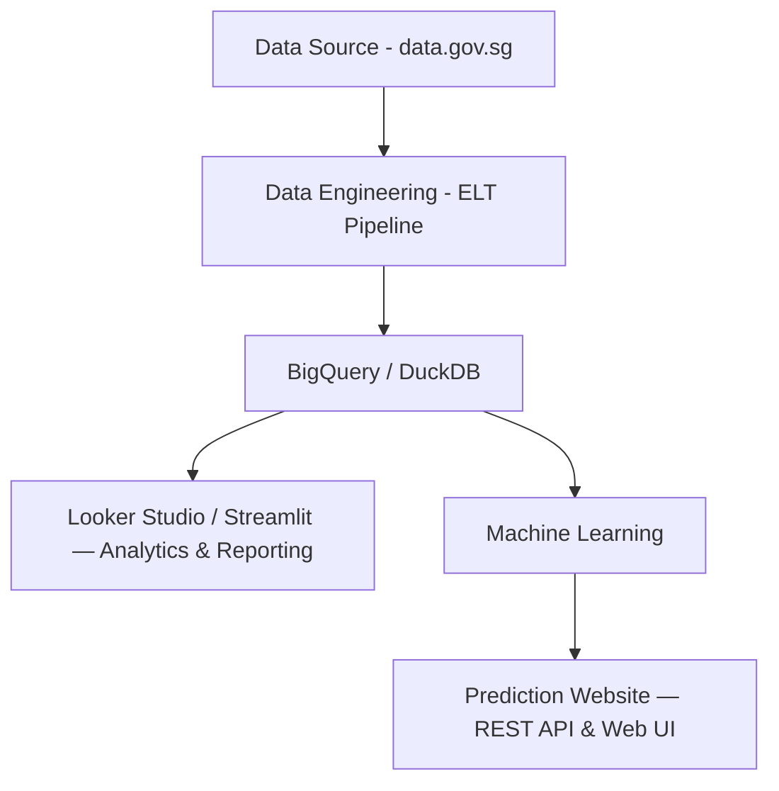

# HDB Resale — E2E Master Directory

## Project Overview

This repository serves as the canonical documentation hub for a multi-repository, end-to-end Machine Learning project predicting Singapore HDB resale flat prices.

The project demonstrates the progressive development of a Machine Learning Engineering system, starting from a basic Proof of Concept (PoC) and gradually introducing production-grade engineering practices, tools and technologies.

## Project Objective

The objective is to build an end-to-end Data Science and Machine Learning platform using publicly available Singapore HDB resale transaction data from [data.gov.sg](https://data.gov.sg).

The platform will support data analytics, visualization and machine learning-based resale price prediction through a web interface.

The project will evolve incrementally, beginning with basic implementations before introducing modern Data Engineering, Machine Learning Engineering, cloud infrastructure and eventually Generative AI and LLM capabilities.

## Project Structure

The project consists of three independently developed and version-controlled repositories.

### 1. Data Engineering

Responsible for:

- Extracting public HDB resale transaction data from data.gov.sg.
- Data cleaning, transformation and validation.
- Loading processed data into BigQuery for analytics and downstream ML usage.

Analytics and visualization will initially be provided through Google Looker Studio, without a separate analytics application repository.

Alternative analytics solutions may be explored if operating costs become a concern.

### 2. Machine Learning

Responsible for:

- Exploratory Data Analysis (EDA) for model development.
- Feature engineering and preprocessing.
- Model training and evaluation.
- Generating and managing prediction model artifacts.

### 3. Prediction Website

Responsible for:

- Providing a REST API for model inference.
- Providing a simple web interface for users to request resale price predictions.
- Integrating additional capabilities, including GenAI and LLM features, in future versions.

## High-Level Architecture

This architecture represents the intended system. Early development versions may use simpler local implementations before introducing cloud services.

## Versioning Strategy

The Master Directory and each component repository maintain independent versioning and development histories.

- **Master Directory:** Overall project documentation, architecture and project-level progress.
- **Data Engineering:** Data pipeline development and engineering progress.
- **Machine Learning:** Model development, experiments and ML engineering progress.
- **Prediction Website:** API, user interface and deployment progress.

Version numbers are independent and do not need to be synchronized across repositories.

## Development Progress

The project will begin with a minimal working Proof of Concept (PoC).

Production-grade practices, infrastructure and additional features will be introduced progressively as the project evolves.

The Master Directory will track overall project milestones and integration progress, while each component repository will maintain its own detailed development history and versioning.

The development roadmap will evolve based on learning objectives, implementation experience and technical requirements.

## Data Engineering

Please refer to the main repository [HDB Resale E2E ELT](https://github.com/mlnotes2718/HDB-Resale-E2E-ELT)

We also created another mono repository to keep different version of the project into a single repository for better comparison. [HDB Resale E2E ELT Mono Repository](https://github.com/mlnotes2718/HDB-Resale-E2E-ELT-Mono)
## Machine Learning

## Prediction Website

## END

